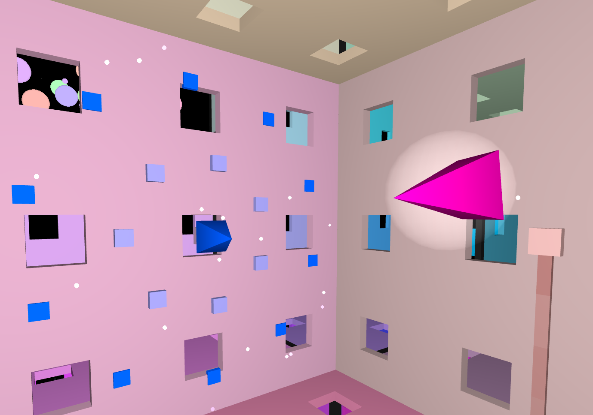
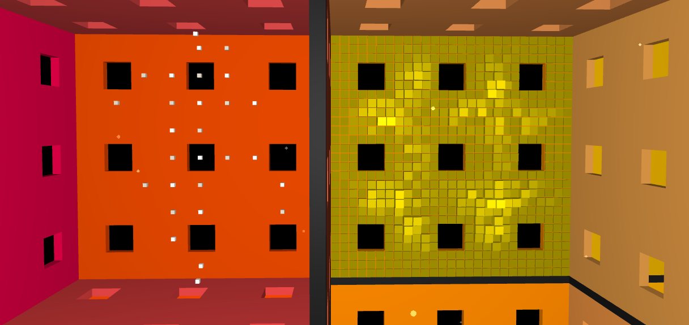
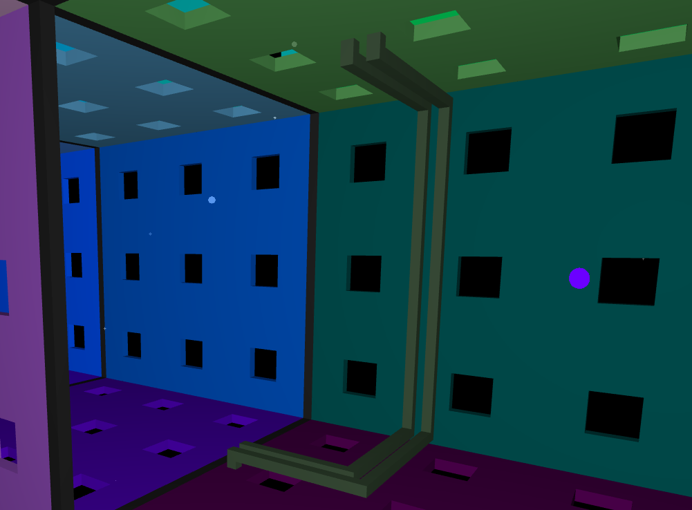
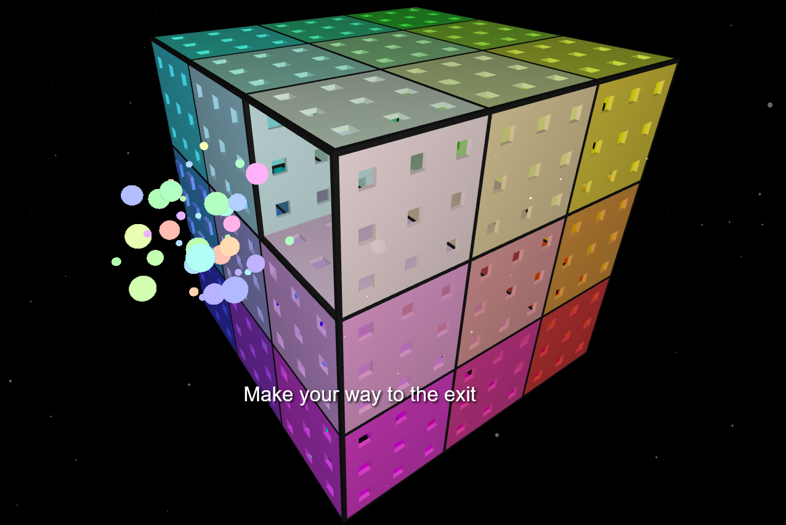

This update is all about helping you know where you are.

### [Click to play 3D Maze](/3d-maze)

<figure class="post-figure-right">

<figcaption>Markers spawn at dead ends - pick one up and leave it wherever it helps.</figcaption>
</figure>

3D Maze now has a variety of new features inside. I'll start with the interactive one: markers allow you to get a little more hands-on with your maze navigation by picking them up and moving them around. Markers spawn at half of the maze's dead ends, and you can place them to remember where you came from, where you've been, where you want to go, or any system you can devise to help you navigate the maze. If you're one of the few [VR](/blog/3d-maze-in-vr/) players, you get to place them with your hands!

<figure class="post-figure-right post-figure-wide">

<figcaption>Strange items on my walls.</figcaption>
</figure>

The scenery that now spreads throughout the maze is placed in a way that aims to give an identity to a new turn or branch. Internally, the game tries to identify _highly branching_ regions of the maze and intentionally puts different scenery near each branch's entrance.

<figure class="post-figure-right">

<figcaption>Critical maze infrastructure: plumbing.</figcaption>
</figure>

It was fun to bring more character to the maze by adding features like pipes and different types of wall... art? Getting the feeling right was a little harder - I wanted the scenery to respect the maze's minimal cubic atmosphere, and yet be interesting and unique enough that it might make you remember an intersection you've seen before. Despite my initial concerns, the more mazes I tested with decorations, the more important this addition felt to me; the old mazes feel quite plain and empty now.

I hope you'll agree that the scenery adds something to the maze. But if you don't, you are free to customize - the new maze customization menu allows toggling marker spawns and scenery. I already have more ideas to add to this menu, perhaps different styles of maze generation or color palettes.

## Additional Changes

<figure class="post-figure-right">

<figcaption>The first-time orientation, showing new players how the maze fits together.</figcaption>
</figure>

- Added a first-time flyover to help orient new players.
- Mobile visualizes the left thumb's 'joystick', making it more intuitive.
- Fixed a bug due to Chromium browsers reporting spontaneous huge mouse movements - the game ignores them now.

## Looking Forward
Now that there are things throughout the maze and a first interactable item, I'm hoping to explore other scenery or mechanics I can add.

## Feedback
Let me know what you think! Feel free to [open a github issue](https://github.com/chrisraff/3d-maze/issues) or shoot me a message on [linkedin](https://www.linkedin.com/in/chris-raff/).
